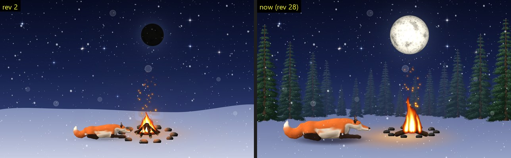
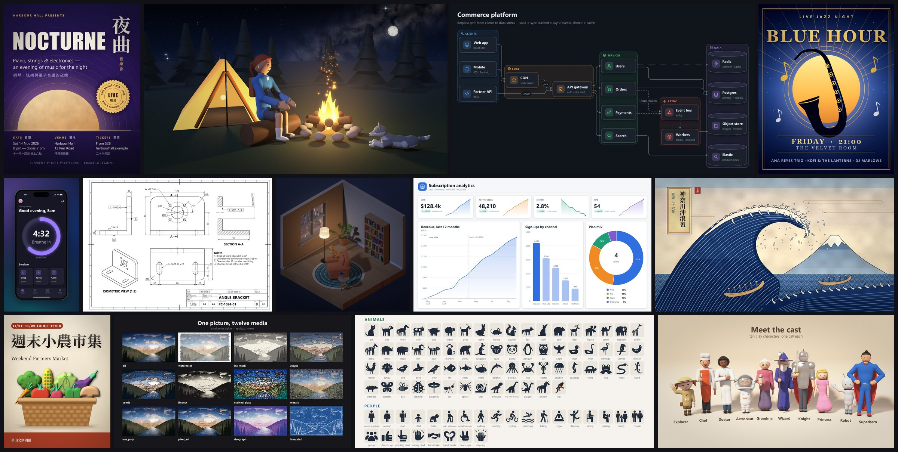

# Changelog

## 0.6.0 (unreleased)

pixelcanvas is now **easel**, a command-line paint program an agent drives stage by stage. The old tool, where the
model wrote Python that drew vector art with kits of subject generators, is gone: the studio, the kits (flora,
clay, pictograms, figure, creature, solid, diagram, chart, ui, drafting and the rest), the art media, the JSON spec
mode, the scenes and templates, the `tools/` scripts, the MCP server, the `pixelcanvas` and `pixelcanvas-lite`
skills and the gallery. The `pixelcanvas` command now runs easel.

### easel

- **A picture is a project folder** (`pic.easel/`): the reference, one PNG per layer, regions, an undo history and a
  journal of every command. `easel undo` / `redo` restore it byte for byte.
- **Stages like a painter**: plan, sketch, line, flat, shade, detail, finish for cel, ink and poster pictures; plan,
  sketch, block-in, forms, detail, finish for paintings and photographs. Each stage paints on its own layer and has
  a gate easel measures per region; `easel stage done` moves on when it passes or when the agent gives a reason.
- **A report after every command**: scores `before -> after`, warnings, the worst spots, a `VIEW:` picture of the
  canvas, a `VIEW-REF:` picture of the reference and one `NEXT:` line. `easel todo --all` prints the work list.
- **Three modes**: `trace` (stage commands follow the reference; the agent plans regions, orders the work, checks and
  refines), `hand` (the agent places every mark, the reference beside it) and `free` (a text request, no reference).
- **Detail levels**: `easel detail all`, then `easel detail <region> --level 1` region by region in the ranked order,
  `easel dot all`, `easel sharpen`. The strokes follow the reference and take their colours from it along the stroke; every
  report prints the share retouched.
- **Hand tools** for what a stage misses: `stroke` (with `--color pick --snap`), `fill`, `shape`, `gradient`,
  `erase`, `smooth`, `adjust`.
- **Export**: `easel export final.png --psd --ora --timelapse film.gif --stages dir`.
- **Results**: on a private set of 93 reference pictures the redraw path reaches a judge mean of 9.42 of 10, with
  88 of 93 rated the same quality as the reference. In the redraw path the strokes follow the reference and take
  their colours from it along the stroke, and no picture is retouched pixel by pixel. A Qwen 3.8 Flash class model driving the
  skill in Claude Code or opencode finishes a redraw in about 22-45 minutes and 46-75 commands; on 14 anime pictures its
  redraws have a judge mean of 9.57, with 13 of 14 rated the same quality as the reference (the scripted path on the
  same pictures: 9.50, 13 of 14).

### Install and packaging

- Console scripts: `easel`, `pixelcanvas` (the same program) and `easel-install-skill` (copies the skill into
  `~/.claude/skills/easel`, `--opencode` for `~/.config/opencode/skills/easel`, `--to DIR` for any skills folder;
  `--force` replaces an existing one).
- Dependencies: numpy, Pillow, opencv-python-headless, scikit-image, scipy.
- The wheel carries the skill as `pixelcanvas/easel/skill/SKILL.md`.
- Removed: `pixelcanvas install-skill`, `pixelcanvas doctor`, `pixelcanvas render` and every other subcommand of the
  old command, the `fast` and `easel` extras, `tools/install_skill.py` and the `Makefile`.

## 0.5.0 (2026-11-14)

A picture is now a living state your agent edits with tools. Until 0.4 the agent wrote a whole scene in one go and
fixed it once or twice; in 0.5 it works in **`pixelcanvas studio`**: one small drawing cell per object, your request
as a checklist, review notes and a revision history, and every command changes one thing, re-renders only that,
checks the picture against the request and prints one `NEXT:` line. Draft in one write, look, write down the weak
points, fix each with the smallest tool, deliver. A later "make the fox bigger" is one more command on the same
picture.

### What you can now do

- **Draw in the studio**: `studio new NAME --prompt "REQUEST" --size WxH --out PATH.png` reads the request into a
  numbered checklist (each thing with its count and colour, each place, each quoted text) and writes `draft.py`;
  `studio add --from draft.py` turns its `# %% name` sections into layers and renders them all.
- **Follow one `NEXT:` line**: a failing cell first, then each open item with the command that settles it
  (`copy apple --total 3`, `put apple* in bowl`), then up to three review rounds, then `deliver`.
- **Review by looking**: `studio look` writes one sheet (the picture with a 0.1 grid and layer boxes, every object
  alone); `look L`, `look --zoom X0 Y0 X1 Y1`, and `look --text` for models without vision. `note add "..." "..."`
  records every weak point in one call and NEXT walks through them.
- **Fix with the smallest tool**: `move`, `scale`, `rotate`, `flip`, `fit`, `order`, `put A on|in|left-of|above.. B`,
  `copy --total N --row | --grid`, `recolor`, `crop`, `set L outline= shadow= glow= tint= blur=`, `set scene light=
  grade= paper=`, or rewrite one cell file and `render`; `batch "CMD" "CMD"` runs several with one report and `NAME*`
  names a cell with its copies.
- **Keep the picture safe**: a failing cell keeps its last good render and the report names the line (and `studio api
  NAME` for a wrong argument); `undo`, `redo`, `goto REV` restore code and parameters; `history` shows the request
  score of every revision; `compare REV REV` puts two side by side.
- **Keep the file current**: the `--out` file is rewritten after every command; follow-up requests run on the same
  state with `studio -p NAME ...`, and `set scene prompt="..."` updates the checklist for a changed request.
- **Real layers**: `deliver --layers` writes PSD and ORA with one layer per object; `deliver --scale 2` renders
  larger; `export NAME.py` writes a scene file for `tools/render.py`.
- **Charts, diagrams, drawings and UI** come in as one layer (`add base --scene FILE.py`) with text and stamps on top.
- **Deliver in a real art medium**: `studio set scene medium=render|flat|oil|watercolour|ink|pixel|off` (dials
  `medium_strength`, `medium_mark`, `medium_palette`, `medium_paper`). The layers become per-pixel buffers (local
  colour recorded apart from shading, a relief per shape, normals, depth, emission), one key light lights them (form
  shadow, cast shadows on the floor, contact occlusion), and the medium paints the result as a process of its own: oil
  strokes along the form, watercolour washes with pooled edges on paper, ink contours and hatching that wraps the form,
  a pixel grid in a small palette. `studio new` reads the medium from the request ("a watercolour of", "oil painting",
  "ink drawing", "pixel art", "3D render"); changing it runs no section again. Medium checks keep
  the drawing's value pattern, the requested colours, the contrast of each thing and legible text. `studio stages`
  writes one strip: flat silhouettes, relief clay, lit colour, the medium. New package `pixelcanvas/medium/`, page
  `references/medium.md`.
- **Three looks, then finished**: after the third look the picture is finished for good; a later change does not ask
  for another look, and only a failing section, an open item or an open note brings work back.
- **Every report names the file**: `picture file: <path> (WxH, written now)`; the installed SKILL.md names the
  reference folder (`references: <abs>/`).
- **Calls and options**: a wrong option reports every unknown option of the section at once with the call's signature;
  bare hex colours (`"3a4048"`) work in Python calls; `set` takes multi-word values (`grade=warm night`).
- **Placing**: `put` never shrinks a thing below 0.8 to satisfy a place; places are judged on the solid part of a layer;
  a 3D scene is one section with its named objects measured one by one.

### Tools

- `pixelcanvas studio` (`tools/studio.py`, package `pixelcanvas/studio/`): 34 verbs (`studio help`), a picture folder
  `./art/NAME/` with `picture.json`, `layers/`, `draft.py`, `preview.png`, `look.png`, a render cache and every
  revision in `history/`.
- `studio api NAME ..` prints any drawing call's exact arguments, first doc lines and an example; `studio api WORD`
  lists every call with that word; `studio api` alone prints the short map of shapes, paint options, solids and kits.
- A cell sees `box("L")` and `anchor("L", "mouth")`: a lantern drawn at the fox's mouth follows the fox when it moves.
- SKILL.md is rewritten around the studio loop and its fix table; `references/studio.md` documents every command.
- Built and tuned with a local model (Qwen 3.8 Flash Next) driving the studio through Claude Code and opencode, and
  with Claude models; `docs/INSTALL.md` shows the `opencode.json` entry that lets a local vision model read the
  `look` sheet.
- The MCP server has four studio tools (15 in all): `studio` runs any command and returns the report with the
  preview image, `studio_draft` takes the whole first draft, `studio_layer` redraws one object, `studio_read` returns
  the draft or one cell. An MCP client works in the studio without a shell.
- `install-skill` records `studio.py` as the skill's tool; the `pixelcanvas` command lists `studio`.

### Fixes

- A call that gets the same argument twice explains whether it was passed by position and keyword, or as both
  `color=` and `colour=`.

## 0.4.0 (2026-11-13)

Your agent now draws almost anything you can describe: illustrations, posters, dashboards, architecture diagrams,
floor plans, app screens, 3D product shots and clay characters. It designs the picture, draws it freehand in
Python with the kits as ingredients, checks it against your request and looks at it before handing it over.

First release on PyPI: `pip install pixelcanvas`, or `uvx pixelcanvas doctor` to try it without installing.

### What you can now draw

- **Freehand illustration**: `illustrate.Sketch` places shapes in fractions of the canvas, in nested local frames,
  with blobs, tapered strokes, shading, highlights, outlines, glow, stickers and washes; `cv.draw()` adds a
  supersampled Pillow layer.
- **Lit solids by default**: a photo, a 3D render or a request with no named style gets lit, shaded objects on a
  receding ground (`Sketch.paint(spec=, shadow="ground")`, planar shading of polygon faces), without outlines.
- **Soft-cel and anime**: `Sketch.cel`, `sheen`, `eye`, `blush`, `ink`, `ramp` and `cel_tone`.
- **Posters, cards and type**: poster and card templates, themes, text effects and auto-fitting type in any
  language; 57 one-call backdrops that keep a calm area for the title, and 60 palettes.
- **Charts and dashboards** (`chart`), **diagrams** with automatic layout (`diagram`: flowcharts, architecture,
  trees, sequences, timelines, tables, callouts) and **UI screens** in device frames (`ui`), all also as SVG.
- **Engineering drawings and floor plans** (`drafting`): projected views, sections, dimensions, title blocks, walls,
  doors and plan symbols, saved as PNG, SVG and DXF.
- **3D** (`solid`): numpy ray-marching with prefabs, materials, studio light, perspective and isometric cameras.
- **Clay characters** (`clay`): faces, 22 hair styles, 13 outfits, 15 expressions and 31 poses; 64 animal species in
  15 poses; 33 props.
- **People and animals**: posed, dressed people with hands and faces (`figure`); 54 species with poses, gaits and
  coats (`creature`).
- **Nature and materials**: trees, flowers and plants (`flora`); fire, smoke, water, weather, skies and light
  (`elements`); 80 lit materials (`texture`); 2.5D objects and rooms with one light (`form`).
- **633 pictograms** in six styles (silhouette, duotone, line, shaded, sticker, cutout), also usable as masks.
- **43 art styles**, from oil and watercolour to ukiyo-e and risograph; `styles pick "REQUEST"` chooses one.
- **Text**: a list separator never starts or ends a line, and CJK lookup picks a font that covers the text.

### Tools

- `render SCENE --check` writes a check sheet and a report: image critique, a text audit, the objects drawn and
  where, and the request checked item by item, ending with a FIX block that names what to change.
- The report names a missing thing only when the request clearly asks for it, counts a thing drawn under another
  name, label or comment as present, and ends with "N requested items unconfirmed" or "every requested item is
  confirmed - deliver".
- **Match a reference image** (#5): `match.py REF.png` prints a style sheet (palette with roles, lines, tone bands,
  shadow shifts, highlights, paste-ready constants); `match.py REF.png DRAFT.png` lists the gaps, largest first;
  `render --check --ref REF.png` adds them as a REFERENCE block.
- `kit find "REQUEST"` searches every kit at once and answers with one call per subject.
- `new NAME --prompt "REQUEST"` starts from the matching one of 30 starter templates, filled in for the request.
- Spec mode: `compose --example poster` writes a JSON spec and `compose SPEC.json --check` draws it, in 16 kinds
  from posters to dashboards and 3D scenes. The new **pixelcanvas-lite** skill is built on it, so small local models
  draw finished pictures too.
- `--layers` (PSD / ORA / PNG), `--svg` and `--dxf` on every render; `tools/build_gallery.py` rebuilds the gallery.

### Packaging

- `pip install pixelcanvas`, with a `pixelcanvas` command for every tool: `kit`, `new`, `render`, `compose`, `look`,
  `match`, `styles`, `layers`, `fonts`, `install-skill`, `doctor`, `mcp`.
- `pixelcanvas install-skill` installs both skills for Claude Code, Codex, Cursor, opencode or any Agent Skills
  tool, for one user or one project; `npx skills add treeleaves30760/pixelcanvas` works as before.
- Claude Code plugin: `/plugin marketplace add treeleaves30760/pixelcanvas`, then `/plugin install
  pixelcanvas@pixelcanvas`.
- `pixelcanvas mcp` runs an MCP server with 11 tools and every reference page as a resource, for any MCP client.
- The skill's bootstrap finds or fetches the runtime by itself.
- CI runs the tests on Ubuntu, Windows and macOS with Python 3.9 and 3.13.

## 0.3.0 (2026-11-11)

Editable layers (PSD / ORA / PNG), media stylization, inspection views for vision models, typography and SDF
shapes; the skill installs with `npx skills add`.
