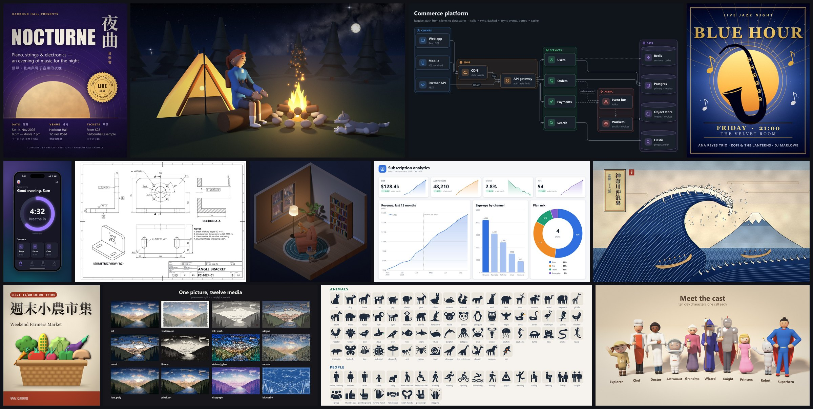

# Changelog

## 0.4.0 (2026-11-13)

Your agent now draws almost anything you can describe: illustrations, posters, dashboards, architecture diagrams,
floor plans, app screens, 3D product shots and clay characters. It designs the picture, draws it freehand in
Python with the kits as ingredients, checks it against your request and looks at it before handing it over.

First release on PyPI: `pip install pixelcanvas`, or `uvx pixelcanvas doctor` to try it without installing.

### What you can now draw

- **Freehand illustration**: `illustrate.Sketch` places shapes in fractions of the canvas, in nested local frames,
  with blobs, tapered strokes, shading, highlights, outlines, glow, stickers and washes; `cv.draw()` adds a
  supersampled Pillow layer.
- **Posters, cards and type**: poster and card templates, themes, text effects and auto-fitting type in any
  language; 57 one-call backdrops that keep a calm area for the title, and 60 palettes.
- **Charts and dashboards** (`chart`), **diagrams** with automatic layout (`diagram`: flowcharts, architecture,
  trees, sequences, timelines, tables, callouts) and **UI screens** in device frames (`ui`), all also as SVG.
- **Engineering drawings and floor plans** (`drafting`): projected views, sections, dimensions, title blocks, walls,
  doors and plan symbols, saved as PNG, SVG and DXF.
- **3D** (`solid`): numpy ray-marching with prefabs, materials, studio light, perspective and isometric cameras.
- **Clay characters** (`clay`): faces, 22 hair styles, 13 outfits, 15 expressions and 31 poses; 64 animal species in
  15 poses; 33 props.
- **People and animals**: posed, dressed people with hands and faces (`figure`); 54 species with poses, gaits and
  coats (`creature`).
- **Nature and materials**: trees, flowers and plants (`flora`); fire, smoke, water, weather, skies and light
  (`elements`); 80 lit materials (`texture`); 2.5D objects and rooms with one light (`form`).
- **633 pictograms** in six styles (silhouette, duotone, line, shaded, sticker, cutout), also usable as masks.
- **43 art styles**, from oil and watercolour to ukiyo-e and risograph; `styles pick "REQUEST"` chooses one.

### Tools

- `render SCENE --check` writes a check sheet and a report: image critique, a text audit, the objects drawn and
  where, and the request checked item by item, ending with a FIX block that names what to change.
- `kit find "REQUEST"` searches every kit at once and answers with one call per subject.
- `new NAME --prompt "REQUEST"` starts from the matching one of 30 starter templates, filled in for the request.
- Spec mode: `compose --example poster` writes a JSON spec and `compose SPEC.json --check` draws it, in 16 kinds
  from posters to dashboards and 3D scenes. The new **pixelcanvas-lite** skill is built on it, so small local models
  draw finished pictures too.
- `--layers` (PSD / ORA / PNG), `--svg` and `--dxf` on every render; `tools/build_gallery.py` rebuilds the gallery.

### Packaging

- `pip install pixelcanvas`, with a `pixelcanvas` command for every tool: `kit`, `new`, `render`, `compose`, `look`,
  `styles`, `layers`, `fonts`, `install-skill`, `doctor`, `mcp`.
- `pixelcanvas install-skill` installs both skills for Claude Code, Codex, Cursor, opencode or any Agent Skills
  tool, for one user or one project; `npx skills add treeleaves30760/pixelcanvas` works as before.
- Claude Code plugin: `/plugin marketplace add treeleaves30760/pixelcanvas`, then `/plugin install
  pixelcanvas@pixelcanvas`.
- `pixelcanvas mcp` runs an MCP server with 11 tools and every reference page as a resource, for any MCP client.
- The skill's bootstrap finds or fetches the runtime by itself.

## 0.3.0 (2026-11-11)

Editable layers (PSD / ORA / PNG), media stylization, inspection views for vision models, typography and SDF
shapes; the skill installs with `npx skills add`.
