# pixelcanvas — 讓 AI 用程式畫圖

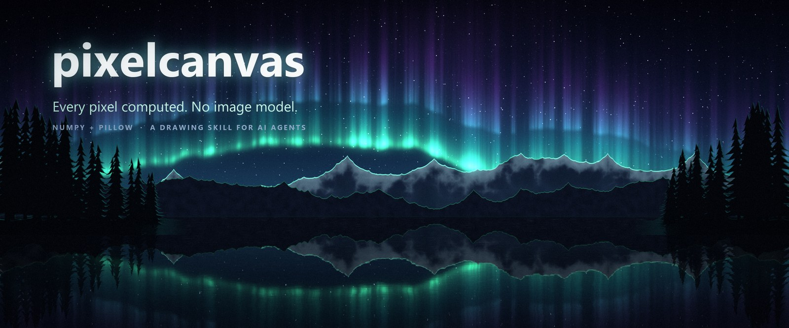

[English](README.md)

**pixelcanvas** 讓「不能生成圖片」的語言模型也能畫出好看的圖。天空、雲、山、水、城市、星空、光線、海報、文字排版，
全部用 numpy + Pillow 從噪聲、遮罩、距離場（SDF）、文字點陣化與混合算出來。沒有任何素材圖，也不需要擴散模型。

模型的工作方式就像插畫家：**構圖 → 寫場景腳本 → 渲染草稿 → 看圖 → 修正 → 再渲染**。
「看圖」這一步，本專案給視覺語言模型（VLM）準備了專用工具：座標格線、放大檢視、明度圖、逐步驟快照、參數掃描。
沒有視覺能力的模型則改看文字報告。

| | |
|---|---|
| 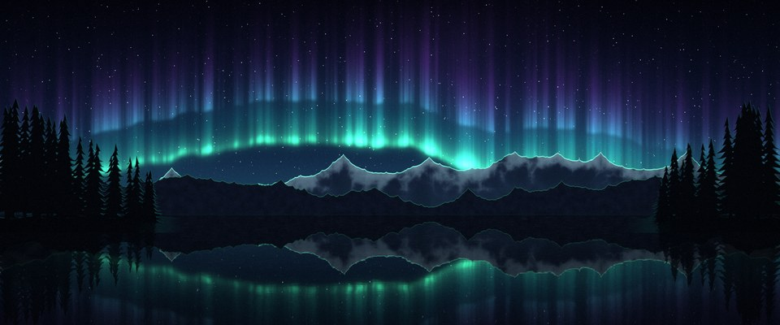 |  |
|  |  |
| 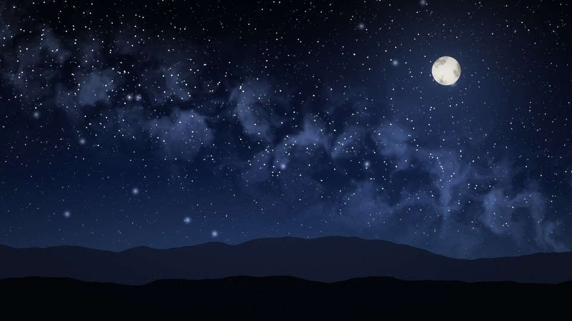 | 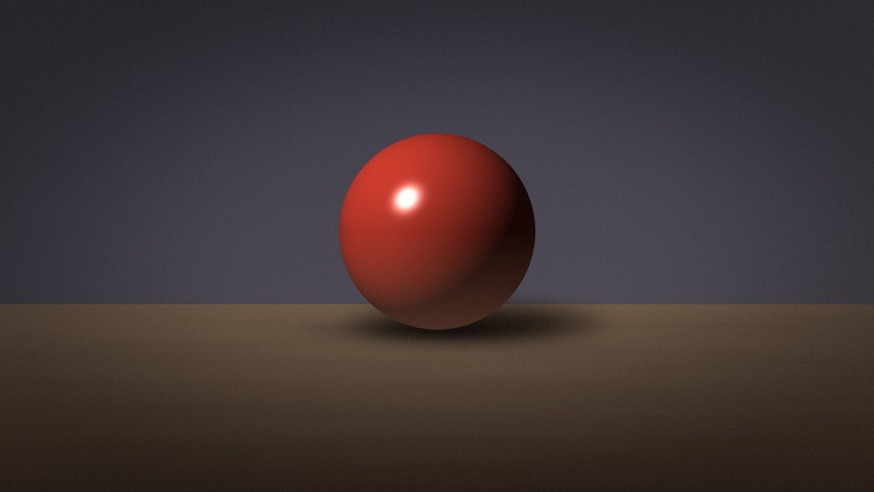 |

<p align="center">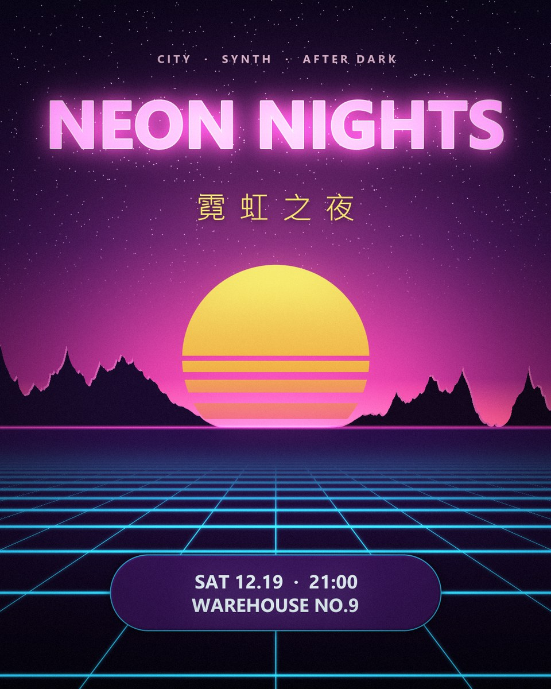</p>

以上每一張（包含最上面的橫幅與它的標題文字）都只是 [`scenes/`](scenes/) 裡的一個 Python 檔。

## 安裝與第一次渲染

```bash
pip install -r requirements.txt                          # numpy、Pillow（scipy 可選，讓模糊 / 取樣更快）
python tools/render.py --list                            # 列出場景
python tools/render.py mountains_sunset --scale 0.5      # 草稿 960x540，幾秒
python tools/render.py mountains_sunset --check          # 全尺寸 1920x1080 + 診斷圖 + 自動警告
python -m pytest -q                                      # 測試（約 5 秒）
```

輸出在 `outputs/`（PNG + `_preview.jpg`）。

## 為什麼適合視覺模型

VLM 很會判斷整體好不好看，但有三個弱點：讀不準位置、看不到小瑕疵、看不出明暗結構。
它也常常描述「本來想畫的」，而不是畫面上「實際有的」。下面每個工具對付其中一個弱點，並輸出一張圖讓模型看：

| 工具 | 模型看到什麼 | 用途 |
|---|---|---|
| `render.py 場景 --check` | 2x2 診斷圖：座標格線、4 階明度圖、邊緣圖、96px 縮圖，並印出自動警告 | 每次渲染後的第一眼 |
| `look.py guides 圖` | 標好比例座標的格線（每 0.1 一條）+ 三分線 | 讀出位置（「地平線在 V 0.60」），不要用猜的 |
| `look.py zoom 圖 u0 v0 u1 v1` | 放大的局部（最近鄰保留像素），標籤沿用整張圖的座標 | 鋸齒、色階斷層、接縫、文字邊緣、缺字 |
| `look.py values 圖` | 模糊後分階的明度圖（瞇眼測試） | 構圖還讀不讀得出來、層次分不分得開 |
| `look.py edges 圖` | 梯度強度圖 | 剪影、細節分布、哪裡最搶眼 |
| `render.py 場景 --stages` | 每個繪圖步驟後的畫面，並排成一張 | 找出畫面在哪一步壞掉 |
| `render.py 場景 --sweep 名稱 v1 v2 v3` / `--seeds 1 2 3 4` | 一張標好標籤的變體對照圖 | 一次看完再挑值，不用一個值一個值慢慢試 |
| `render.py 場景 --set 名稱=運算式` | — | 不改檔案就試改動 |
| `look.py critique 圖` | 文字警告：過曝、明暗範圍太窄、地平線正中央、焦點貼邊、飽和過頭、左右失衡 | 肉眼容易放過的客觀檢查 |
| `look.py probe 圖 U,V ...` | 指定點的精確 hex / 亮度 / 色相 | 文字對比、確認顏色是否符合意圖 |
| `look.py sheet A B C --labels ...` | 標好標籤的多版本對照 | 改前改後 |
| `look.py report 圖` | 完整文字描述：九宮格色彩 / 亮度 / 質感、主色、剖面、ASCII 亮度圖 | **沒有**視覺能力的模型 |

### 迭代實際長這樣

下面是製作最上方橫幅時的真實草稿，每一輪只修工具指出的 2~4 個最嚴重的問題：

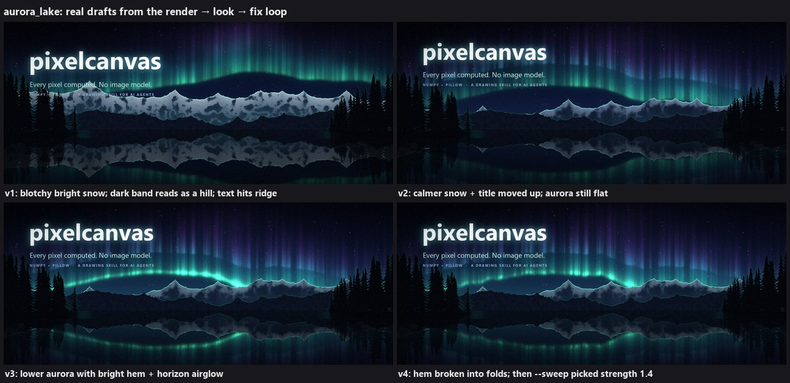

**`--check`**：一張圖看完座標格線、明度圖、邊緣圖、縮圖，並印出自動警告

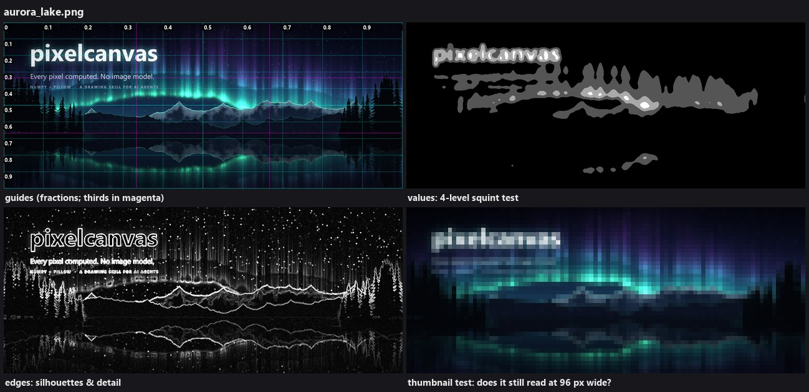

**`--stages`**：每個繪圖步驟後的畫面

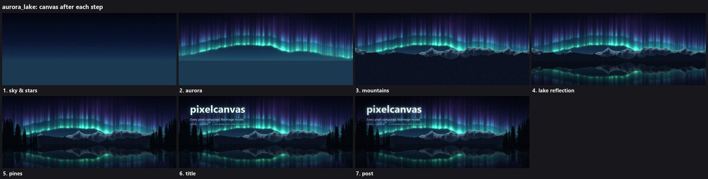

**`--sweep AURORA_STRENGTH 1.0 1.4 1.8 2.2`**：一眼挑出最好的值

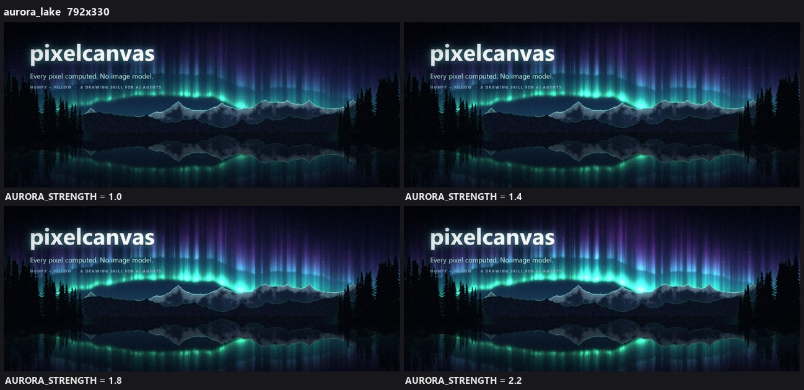

**`zoom`**：放大局部，標籤沿用整張圖的座標

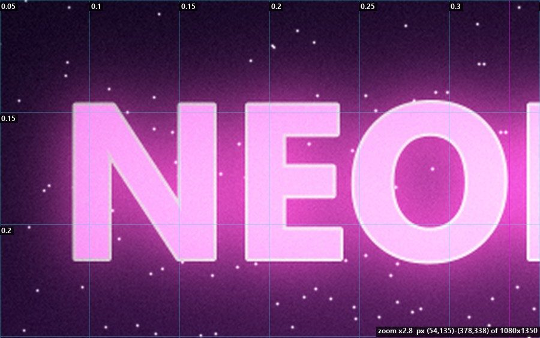

## 可編輯圖層（PSD / OpenRaster）

`python tools/render.py 場景 --layers` 會另外輸出可讓人修改的圖層檔：`場景.psd`（Photoshop、Photopea、GIMP、
Affinity）、`場景.ora`（Krita、GIMP）與 `場景_layers/`（每層一張 PNG + `layers.json`）。場景裡每個 `log("步驟")`
就是一個圖層（天空、每一層山、河、樹、標題、後製…）。有畫上去的物件在它的遮罩範圍內是不透明的，所以移動或隱藏它，
後面的東西仍然完整；光暈是半透明圖層，最後的調色會併入每一層，隱藏物件時不會留下殘影。全部疊回去與最終渲染完全一致（誤差 ±2/255）。
`tools/layers.py sheet|compose|export` 可看每一層、隱藏某些層重新合成，或把改過的 PNG 重新打包成 PSD。

## 文字、排版與向量形狀

圖像模型常把字寫錯。本專案用真正的字型點陣化文字，所以文字一定跟使用者要求的一樣，中文、日文也沒問題：

```python
from pixelcanvas import *
from pixelcanvas import sdf

cv = Canvas(1080, 1350)
cv.gradient([(0, "#0b0620"), (1, "#3a1050")])
cv.text("NEON NIGHTS", box=(60, 120, 1020, 300), color=(1.5, 0.7, 1.3), bold=True,      # 自動縮放塞進框內
        glow=dict(radius=30, color="#ff3cac"), outline=2, outline_color="#fff0fa")
cv.text("霓虹之夜", (540, cv.last_bbox[3] + 30), 64, "#ffe66d", anchor="mt", tracking=0.4)  # 自動選用中文字型
X, Y = cv.xy()
card = sdf.sd_box(X, Y, 540, 1150, 320, 70, radius=70)                                     # 銳利的圓角矩形
cv.paint("#2a0f4a", sdf.fill(card)).paint("#2bd2ff", sdf.outline(card, 2))
cv.text("SAT 12.19 · 21:00", box=(220, 1080, 860, 1220), padding=24, color="#e8f9ff", bold=True)
cv.soft_clip(0.85).save("poster.png")
```

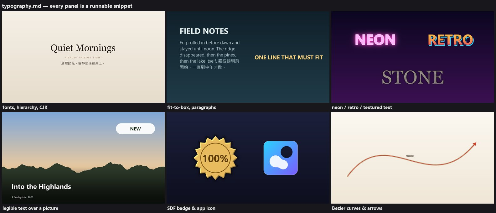

- **文字**（`pixelcanvas.text`）：跨平台找字型（`find_font`、`python tools/fonts.py --sheet`）；多行、英文斷字 /
  中文逐字換行（含標點避頭規則）、對齊、字距；自動塞進框內；描邊、陰影、霓虹光暈、漸層填色；
  `text_mask` 可以把文字當遮罩填任何材質。
- **形狀**（`pixelcanvas.sdf`）：圓、橢圓、圓角矩形、膠囊、多邊形、星形、圓環、弧線的距離場，可做聯集 / 交集 /
  差集 / 平滑聯集，再加描邊、光暈、斜面打光。任何解析度下邊緣都有抗鋸齒。
- **曲線**：`bezier_points` + `line_mask`，用來畫緞帶、箭頭、圖解線條。
- **版面指引**（海報、方形、限時動態、影片縮圖、投影片尺寸；層級；邊距；對比）：
  [`typography.md`](skills/pixelcanvas/references/typography.md)。

## 給 AI 用：pixelcanvas skill

`skills/pixelcanvas/` 是標準格式的 Agent Skill（`SKILL.md` + `references/`），教模型走完整個流程：
構圖 → 場景 → 草稿 → 看圖 → 修正 → 全尺寸。

- [`SKILL.md`](skills/pixelcanvas/SKILL.md)：完整流程、該從哪個範例開始、看圖工具表、繪圖心法
- [`references/api.md`](skills/pixelcanvas/references/api.md)：API 速查
- [`references/techniques.md`](skills/pixelcanvas/references/techniques.md)：怎麼畫 X（剪影、體積雲、法線光照、透視地面、倒影、撒點、格點圖樣、體積光、筆刷、修圖、雪地）+ 配色表
- [`references/typography.md`](skills/pixelcanvas/references/typography.md)：文字、特效、可讀性、SDF 形狀、曲線、版面規則
- [`references/review.md`](skills/pixelcanvas/references/review.md)：怎麼看圖（VLM 流程）、檢查清單、症狀 → 修法

（skill 文件以英文撰寫，對各家模型最通用；觸發詞同時包含中文。）

### 安裝到各種工具

| 工具 | 做法 |
|---|---|
| Claude Code | 在本專案裡直接可用（`CLAUDE.md`）；全域安裝：`python tools/install_skill.py` → `~/.claude/skills/pixelcanvas` |
| Codex CLI | `python tools/install_skill.py --tool codex` → `~/.codex/skills/pixelcanvas`；在本專案裡也會讀 `AGENTS.md` |
| 其他支援 SKILL.md 的工具 | `python tools/install_skill.py --dest <該工具的 skills 目錄>` |
| Cursor / Gemini CLI / Copilot / Aider… | 在本專案裡開啟即可（讀 `AGENTS.md`）；或把 `SKILL.md` 內容放進該工具的規則檔 |
| 有程式執行環境的聊天模型 | 上傳整個專案 zip，並貼上 `SKILL.md` 當指示 |

安裝腳本會把本機專案路徑寫進安裝後的 `SKILL.md`，所以在任何資料夾裡說「畫一張 ○○」，模型都找得到這個專案。

## 可以這樣要求

- 「畫一張 2560x1440 的雪夜森林」
- 「做一張爵士之夜的海報，週五 21:00，標題『藍調時刻』」
- 「把 mountains_sunset 改成日出、河改成湖」
- 「畫一張手機桌布：霓虹城市下雨的夜晚」
- 「做一張 YouTube 縮圖，大字寫『十小時雨聲』，背景是暗暗的窗戶」
- 「幫這張照片加暖色暈影和顆粒」

## 專案結構

```
pixelcanvas/              套件
  color.py                rgb / lerp / mix / hsv / smoothstep ...
  noise.py                perlin2d / fbm2d / warp2d / fbm1d（ridged、billow、domain warp）
  masks.py                shape_mask / polygon / circle / rect / band / line_mask / bezier_points / feather
  brush.py                stamp / stroke
  text.py                 字型、排版、換行、自動縮放、文字樣式（描邊 / 陰影 / 光暈 / 漸層）
  sdf.py                  距離場形狀、布林運算、描邊 / 光暈 / 斜面
  filters.py              blend（8 種混合模式）/ 模糊 / 取樣 / 放射模糊 / 體積光 / bloom / 暗角 / 顆粒 / levels ...
  canvas.py               Canvas：建立 / 載入 / 像素 / 上色 / 漸層 / 光暈 / 文字 / 貼圖 / 取樣 / 後製 / 存檔
  vision.py               看圖用的檢視：格線 / 放大 / 明度圖 / 邊緣 / 對照表 / 渲染步驟快照
  layers.py               可編輯圖層：每個繪圖步驟一層 → PSD / ORA / PNG 圖層組、重新合成
  stylize.py              媒材：油畫 / 水彩 / 鉛筆素描 / 動畫賽璐璐 / 畫布紋理
  scenery.py              風景配方：Scene、天空、太陽、雲、山、霧、河、水面、樹、體積光、後製
scenes/                   每張圖一個檔：mountains_sunset、night_sky、still_life、city_dusk、sea_sunset、neon_poster、
                          aurora_lake
                          _template.py（風景）/ _template_poster.py（設計）
skills/pixelcanvas/       Agent Skill（SKILL.md + references/）
tools/
  render.py               渲染（--scale / --size / --seed / --crop / --check / --stages / --layers / --set / --sweep / --seeds）
  layers.py               圖層組：info / sheet（每層對照表）/ compose（隱藏、重新合成修改）/ export（PSD、ORA）
  look.py                 看圖：check / guides / zoom / values / edges / sheet / compare / diff / crop / grid /
                          critique / probe / stats / report
  fonts.py                列出字型、輸出字型樣張
  new_scene.py            從範本建立新場景（--poster 用設計範本）
  install_skill.py        把 skill 安裝到 Claude Code / Codex / 其他工具
tests/                    pytest：套件、所有場景、skill 文件裡的每段範例、工具
gallery/                  定稿；   docs/  README 用圖；   outputs/  渲染輸出（不進 git）
CLAUDE.md / AGENTS.md     給 AI 助理的專案說明
```

## 兩層 API

**低階**（`from pixelcanvas import *`）：任何東西都能從這層畫出來。

```python
from pixelcanvas import *
cv = Canvas(640, 360)
cv.gradient([(0, '#0b1a3a'), (1, '#f6c28f')])          # 天空漸層
X, Y = cv.xy()
cv.glow(400, 200, 60, '#fff0c0', strength=1.2)          # 光暈（HDR）
ridge = 220 - 60 * fbm1d(640, 120, seed=1)              # 山稜線：每一欄的 y
cv.paint('#223344', clamp01(Y - ridge[None, :] + 0.5))  # 稜線以下上色 = 山（1px 抗鋸齒）
cv.text("黃昏", (20, 20), 36, "#ffffff")                 # 文字
cv.soft_clip(0.8).save('demo.png', preview='demo_small.jpg')
```

**高階配方**（`from pixelcanvas.scenery import *`）用來快速組一張風景。像素單位以 1080p 為基準並在內部依解析度縮放，
所以 `--scale 0.5` 的草稿和全尺寸長得一樣：

```python
sc = Scene(1920, 1080, seed=7)
sc.set_horizon(0.62); sc.set_sun(0.6, 0.56, light_dir=(0.9, -0.4)); sc.set_haze(HAZE)
sky(sc, SKY); disc = sun(sc); clouds = cumulus(sc)
mountain_layer(sc, dict(base=0.6, amp=0.2, scale=500, seed=11, fog=0.7, shadow='#6e6e9d', lit='#c5b0bd', snow=0.5))
center, half, t1 = river_course(sc); water, e = water_mask(sc, center, half, t1); water_surface(sc, water, e, t1)
god_rays(sc, disc, clouds); finish(sc)
sc.cv.save('out.png', preview='out_preview.jpg')
```

## 慣例

- **座標**：x 向右、y 向下（`arr[y, x]`）；位置一律用 0~1 的比例。
- **遮罩**：float32 (H, W)，值 0~1。
- **顏色**：`'#rrggbb'`、0~1 的 `(r, g, b)`、`(255, 128, 0)`，或整張 (H, W, 3) 顏色圖。允許大於 1 的 HDR 值，
  最後用 `soft_clip` / `bloom` 收尾。
- **繪製順序**：天空 → 遠 → 近 → 水 → 前景 → 光線 → 文字 → 後製。
