# pixelcanvas — AI image generation with code, no image model needed

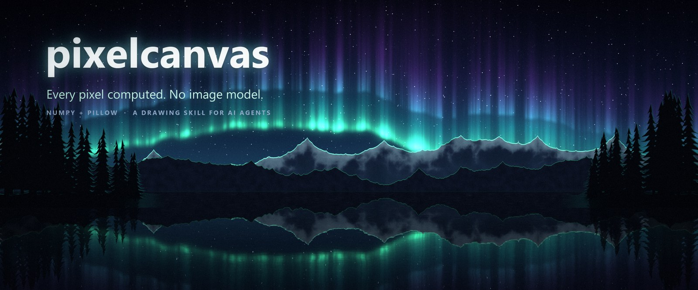

[](LICENSE)


[繁體中文](README-zh.md)

> An **Agent Skill** for Claude Code, Codex, Cursor, Gemini CLI and any tool that reads `SKILL.md`: draw posters,
> wallpapers, landscapes, thumbnails and typography with exact text, edit photos, and export editable **PSD / ORA
> layers**, using only numpy + Pillow. No image model, no API key, no assets.

```bash
npx skills add treeleaves30760/pixelcanvas          # install the skill (interactive: pick your tools)
```

Then ask your assistant: *"Draw a 2560x1440 snowy forest at night"* or *"Make a poster for a jazz night, title 'Blue Hour'"*.

**pixelcanvas** lets a language model that *cannot generate images* still produce good-looking ones. Skies, clouds,
mountains, water, cities, star fields, light, posters, typography — every pixel is computed from noise, masks,
signed distance fields, rasterised text and blending, with numpy + Pillow. There are no image assets and no
diffusion model.

The model works the way an illustrator does: **plan → write a scene script → render a draft → look at it →
fix → re-render**. The project gives a vision-language model (VLM) inspection tools for the "look" step:
coordinate grids, zoom views, value maps, stage-by-stage sheets and parameter sweeps. Models without vision get
a text report instead.

| | |
|---|---|
| 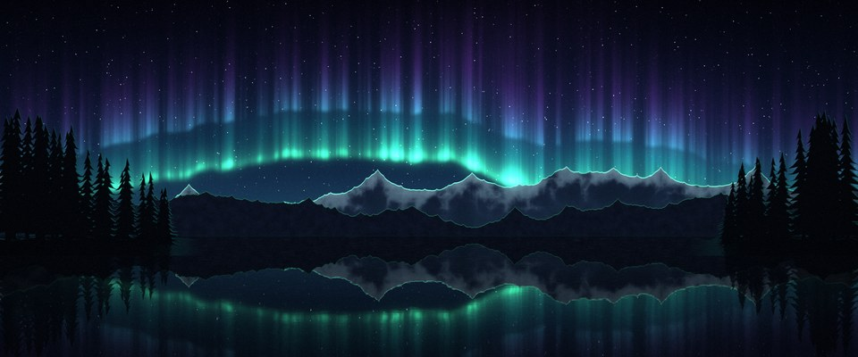 | 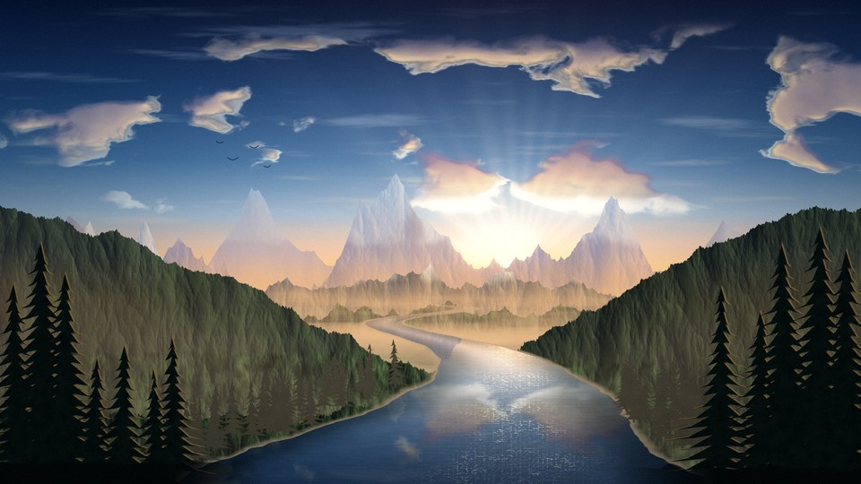 |
|  | 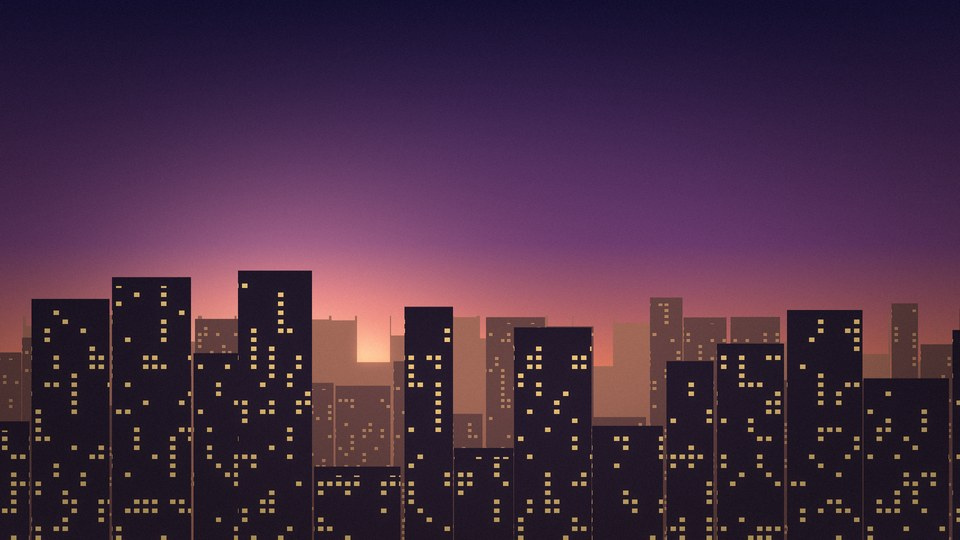 |
| 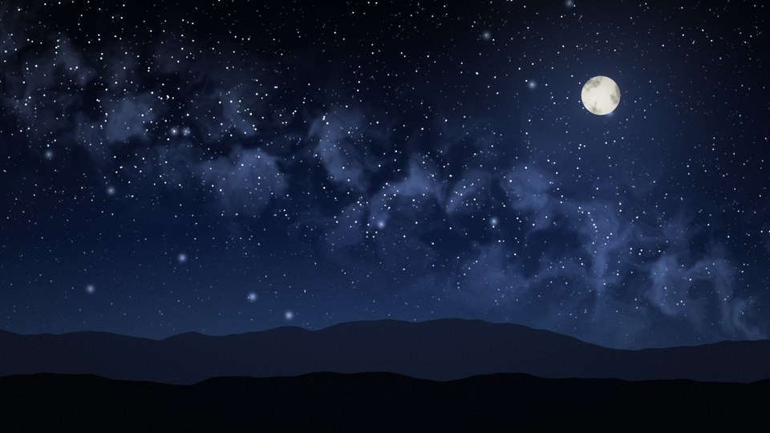 | 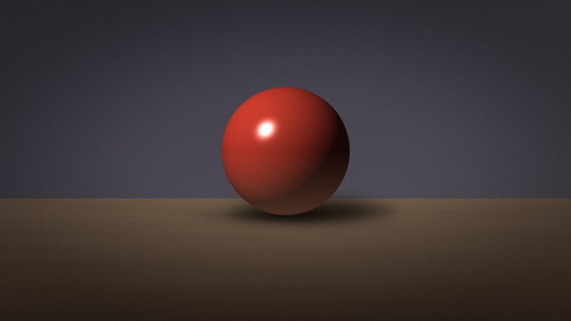 |

<p align="center">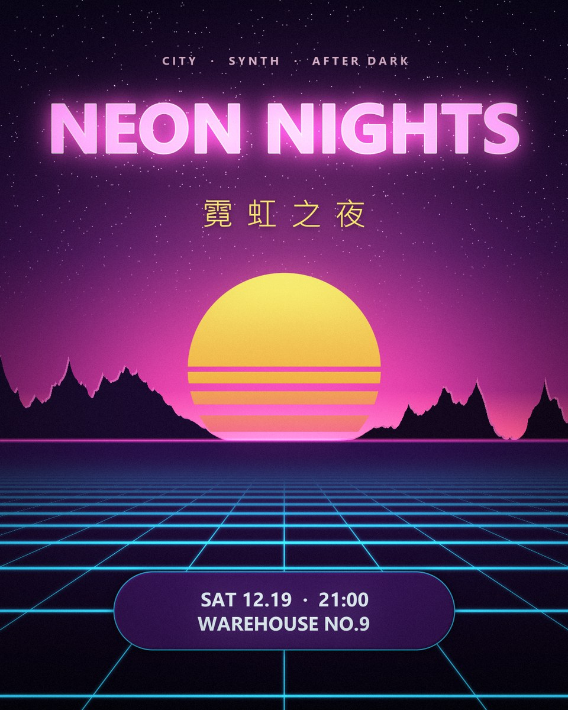</p>

All of the above, including the banner and its title, are plain Python files in [`scenes/`](scenes/).

## Install

| You use | Command |
|---|---|
| Any supported agent (Claude Code, Codex, Cursor, Gemini CLI, Copilot, …) | `npx skills add treeleaves30760/pixelcanvas` |
| Claude Code, global, no prompts | `npx skills add treeleaves30760/pixelcanvas -g -a claude-code -y` |
| Just look at what is inside | `npx skills add treeleaves30760/pixelcanvas --list` |
| Clone and hack on it | `git clone https://github.com/treeleaves30760/pixelcanvas.git && cd pixelcanvas && pip install -r requirements.txt` |

The installed skill is `SKILL.md` + `references/` + `scripts/bootstrap.py`. On first use the assistant runs the
bootstrap script, which downloads the renderer (under 1 MB) to `~/.pixelcanvas` and installs numpy + Pillow if they
are missing. Requires Python 3.9+ and git.

## Quick start

```bash
pip install -r requirements.txt                          # numpy, Pillow (scipy optional: faster blur / sampling)
python tools/render.py --list                            # list scenes
python tools/render.py mountains_sunset --scale 0.5      # draft 960x540, a few seconds
python tools/render.py mountains_sunset --check          # full 1920x1080 + diagnostic sheet + warnings
python -m pytest -q                                      # tests (~5 s)
```

Output goes to `outputs/` (PNG + `_preview.jpg`).

## Why it works for vision models

A VLM judges the overall look of an image well. It is weak at three things: reading exact positions, noticing
small defects, and seeing tonal structure. It also tends to describe what it meant to draw instead of what is
actually there. Each tool below targets one of these weaknesses and writes an image for the model to look at:

| Tool | What the model sees | Use it for |
|---|---|---|
| `render.py SCENE --check` | 2x2 sheet: coordinate guides, 4-level value map, edge map, 96 px thumbnail, plus printed warnings | the first look after every render |
| `look.py guides IMG` | labelled fraction grid (0.1 steps) and rule-of-thirds lines | reading positions ("horizon at V 0.60") instead of guessing |
| `look.py zoom IMG u0 v0 u1 v1` | enlarged crop with nearest-neighbour pixels, labelled in full-image coordinates | aliasing, banding, seams, text edges, missing glyphs |
| `look.py values IMG` | blurred, posterised luminance (the squint test) | whether the composition still reads and the layers separate |
| `look.py edges IMG` | gradient magnitude | silhouettes, where detail sits, what pulls the eye |
| `render.py SCENE --stages` | the canvas after each drawing step, side by side | finding the step where the picture went wrong |
| `render.py SCENE --sweep NAME v1 v2 v3` / `--seeds 1 2 3 4` | one labelled contact sheet of variants | picking a value in one look instead of tweaking one value at a time |
| `render.py SCENE --set NAME=EXPR` | — | trying a change without editing the file |
| `look.py critique IMG` | text warnings: clipping, flat tonal range, centred horizon, focal point at the edge, garish saturation, imbalance | objective checks that are easy to miss by eye |
| `look.py probe IMG U,V ...` | exact hex / luma / hue at given points | text contrast, checking colour intent |
| `look.py sheet A B C --labels ...` | labelled comparison of iterations | before / after |
| `look.py report IMG` | full text description: 3x3 colour, luma and texture; dominant colours; profiles; ASCII luma map | models **without** vision |

### What the loop looks like

Real drafts from making the banner above, each round fixing the 2~4 worst problems the tools pointed out:

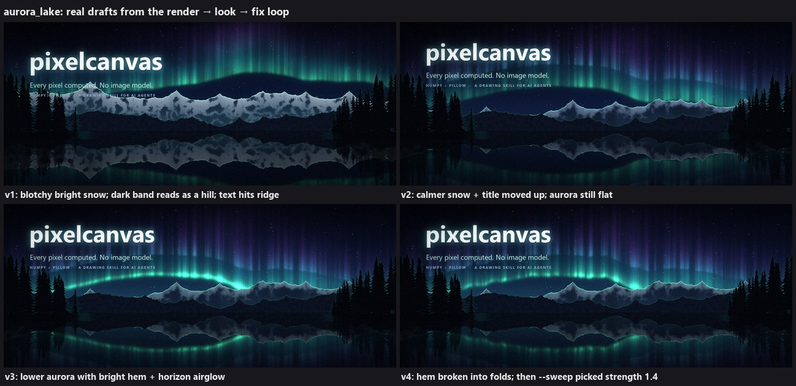

**`--check`**: one sheet with coordinate guides, value map, edges and thumbnail, plus printed warnings

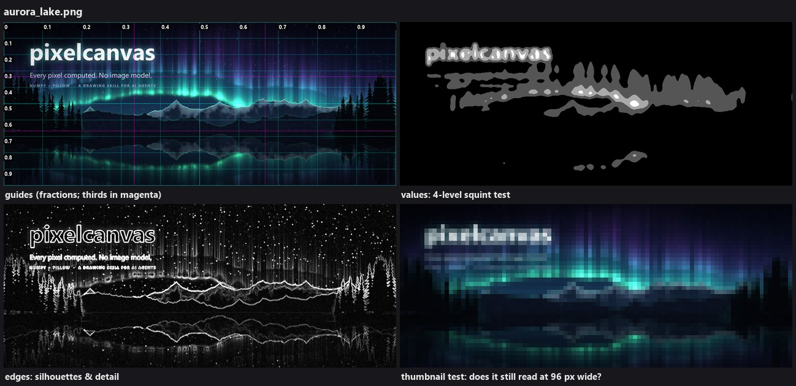

**`--stages`**: the canvas after every drawing step

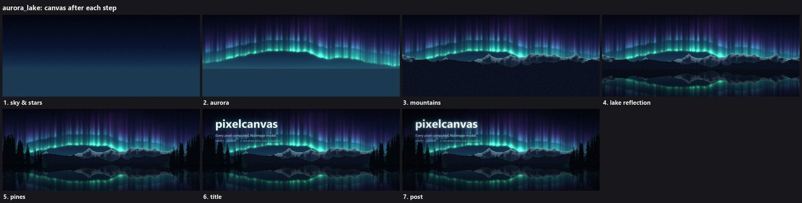

**`--sweep AURORA_STRENGTH 1.0 1.4 1.8 2.2`**: pick a value in one look

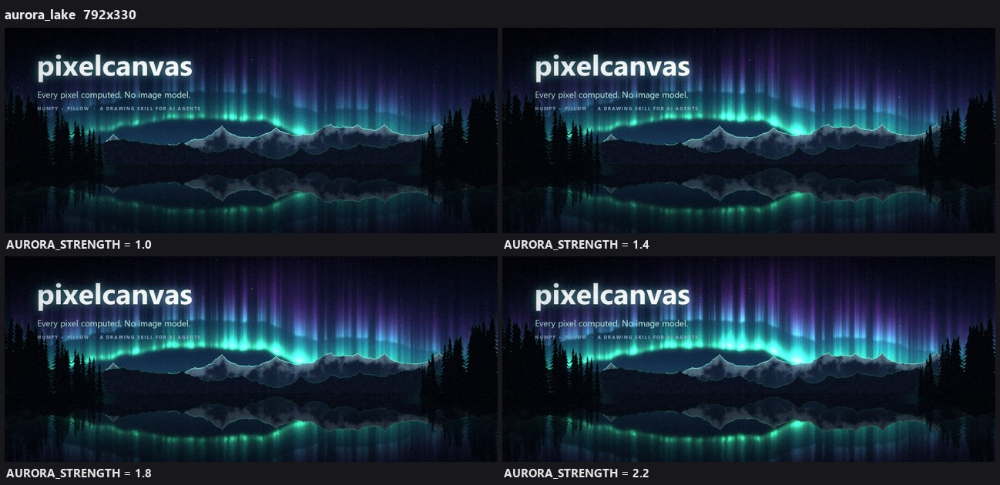

**`zoom`**: enlarged region, labelled in full-image coordinates

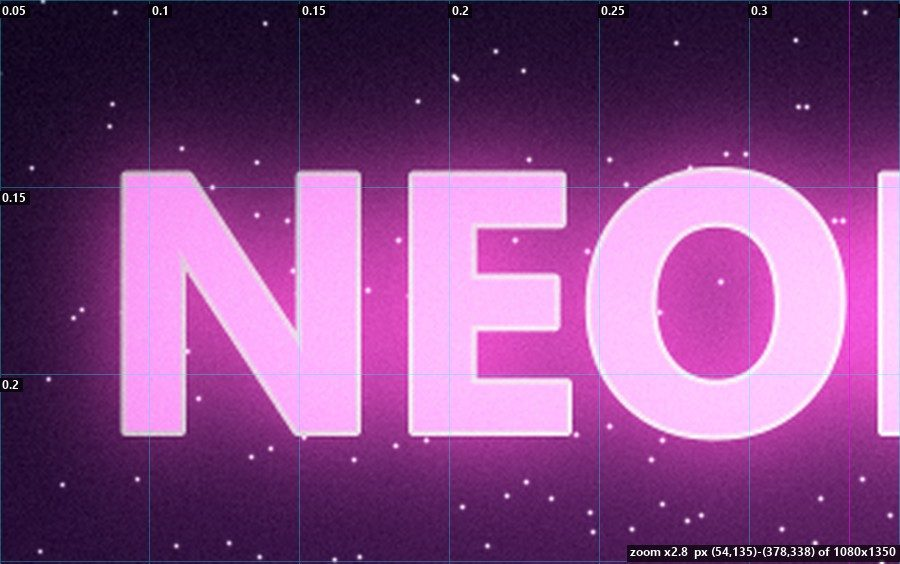

## Editable layers (PSD / OpenRaster)

`python tools/render.py SCENE --layers` also writes the picture as layers a person can edit: `SCENE.psd`
(Photoshop, Photopea, GIMP, Affinity), `SCENE.ora` (Krita, GIMP) and `SCENE_layers/` (one PNG per layer +
`layers.json`). Every `log("step")` in the scene is one layer (sky, each mountain range, river, trees, title, post…).
Painted objects are solid where they were painted, so moving or hiding one leaves what was behind it intact;
glows are see-through layers, and the final grading is folded into every layer so hiding an object leaves no ghost.
An object's soft drop shadow or outer glow is split into a `(halo)` layer grouped with it (a folder in PSD / ORA):
the object keeps crisp edges, and the group hides or moves as one. The stack composites back to the final render exactly (±2/255).
`tools/layers.py sheet|compose|export` shows every layer, re-composites with layers hidden, or rebuilds a PSD
from edited PNGs.

## Text, typography and vector shapes

Image models often misspell text. This project rasterises real fonts, so the text always matches what the user
asked for, including Chinese and Japanese:

```python
from pixelcanvas import *
from pixelcanvas import sdf

cv = Canvas(1080, 1350)
cv.gradient([(0, "#0b0620"), (1, "#3a1050")])
cv.text("NEON NIGHTS", box=(60, 120, 1020, 300), color=(1.5, 0.7, 1.3), bold=True,      # auto-fit into a box
        glow=dict(radius=30, color="#ff3cac"), outline=2, outline_color="#fff0fa")
cv.text("霓虹之夜", (540, cv.last_bbox[3] + 30), 64, "#ffe66d", anchor="mt", tracking=0.4)  # CJK font picked automatically
X, Y = cv.xy()
card = sdf.sd_box(X, Y, 540, 1150, 320, 70, radius=70)                                     # crisp rounded rectangle
cv.paint("#2a0f4a", sdf.fill(card)).paint("#2bd2ff", sdf.outline(card, 2))
cv.text("SAT 12.19 · 21:00", box=(220, 1080, 860, 1220), padding=24, color="#e8f9ff", bold=True)
cv.soft_clip(0.85).save("poster.png")
```

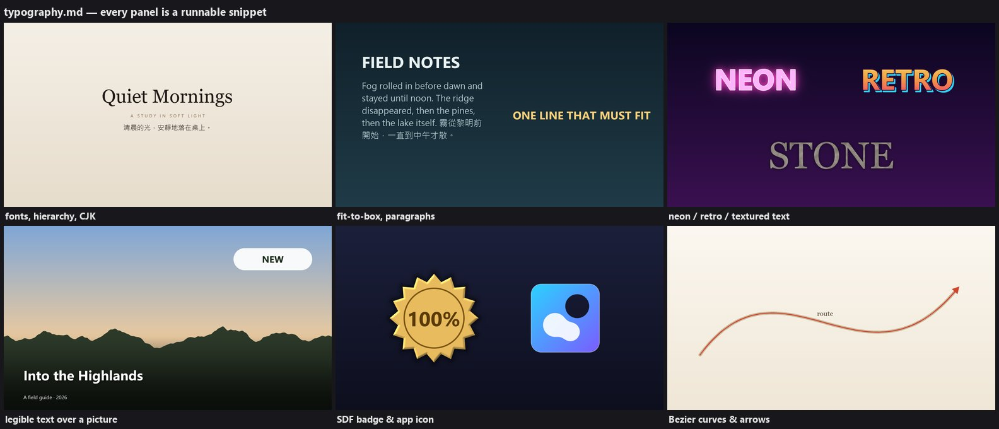

- **Text** (`pixelcanvas.text`): cross-platform font lookup (`find_font`, `python tools/fonts.py --sheet`); multi-line
  text, word / CJK wrapping with line-break rules for punctuation, alignment, letter-spacing; auto-fit into a box;
  outline, shadow, neon glow, gradient fill; and `text_mask` for filling text with any texture.
- **Shapes** (`pixelcanvas.sdf`): signed distance fields for circles, ellipses, rounded boxes, capsules, polygons, stars,
  rings and arcs, with union / intersect / subtract / smooth-union, outlines, glows and bevel shading. Edges are
  anti-aliased at any resolution.
- **Curves**: `bezier_points` + `line_mask` for ribbons, arrows and diagram lines.
- **Layout guidance** (poster, square, story, thumbnail and slide formats; hierarchy; margins; contrast):
  [`typography.md`](skills/pixelcanvas/references/typography.md).

## For AI assistants: the pixelcanvas skill

`skills/pixelcanvas/` is a standard Agent Skill (`SKILL.md` + `references/`). It teaches a model the full loop:
plan → scene → draft → look → fix → full size.

- [`SKILL.md`](skills/pixelcanvas/SKILL.md): the workflow, which example to start from, the look-tools table, and drawing principles
- [`references/api.md`](skills/pixelcanvas/references/api.md): API reference
- [`references/techniques.md`](skills/pixelcanvas/references/techniques.md): how to draw X (silhouettes, volumetric clouds, normal lighting,
  perspective ground, reflections, scatter, grid patterns, light shafts, brushes, photo editing, snow) and palette tables
- [`references/typography.md`](skills/pixelcanvas/references/typography.md): text, effects, legibility, SDF shapes, curves, layout rules
- [`references/review.md`](skills/pixelcanvas/references/review.md): how to look (protocol for VLMs), checklist, symptom → fix

### Install into your tool

| Tool | How |
|---|---|
| Any tool (recommended) | `npx skills add treeleaves30760/pixelcanvas` |
| Claude Code | works inside this repo (`CLAUDE.md`); global install: `python tools/install_skill.py` → `~/.claude/skills/pixelcanvas` |
| Codex CLI | `python tools/install_skill.py --tool codex` → `~/.codex/skills/pixelcanvas`; inside the repo it also reads `AGENTS.md` |
| Other tools that read SKILL.md | `python tools/install_skill.py --dest <that tool's skills dir>` |
| Cursor / Gemini CLI / Copilot / Aider… | open the repo (they read `AGENTS.md`), or paste `SKILL.md` into the tool's rules file |
| Chat models with a code sandbox | upload the repo as a zip and paste `SKILL.md` as instructions |

The installer writes this project's path into the installed `SKILL.md`, so a request like "draw a ..." works from
any folder.

## Things to ask for

- "Draw a 2560x1440 snowy forest at night"
- "Make a poster for a jazz night on Friday 21:00 with the title 'Blue Hour'"
- "Change mountains_sunset to sunrise, and turn the river into a lake"
- "A phone wallpaper: a neon city in the rain"
- "A YouTube thumbnail that says '10 HOURS OF RAIN' over a dark window"
- "Add a warm vignette and grain to this photo"

## Project layout

```
pixelcanvas/              the package
  color.py                rgb / lerp / mix / hsv / smoothstep ...
  noise.py                perlin2d / fbm2d / warp2d / fbm1d (ridged, billow, domain warp)
  masks.py                shape_mask / polygon / circle / rect / band / line_mask / bezier_points / feather
  brush.py                stamp / stroke
  text.py                 fonts, layout, wrapping, fitting, styled text (outline / shadow / glow / gradient)
  sdf.py                  signed distance shapes, boolean ops, outline / glow / bevel
  filters.py              blend (8 modes) / blur / sample / radial blur / light shafts / bloom / vignette / grain / levels ...
  canvas.py               Canvas: create / load / pixels / paint / gradients / glow / text / paste / sample / post / save
  vision.py               inspection views: guides / zoom / value map / edges / contact sheet / render stages
  layers.py               editable layers: one per drawing step → PSD / ORA / PNG stack, re-composite
  stylize.py              media: oil painting / watercolour / pencil sketch / cel-shaded anime / canvas texture
  scenery.py              landscape recipes: Scene, sky, sun, clouds, mountains, mist, rivers, water, trees, god rays, finish
scenes/                   one file per picture: mountains_sunset, night_sky, still_life, city_dusk, sea_sunset, neon_poster,
                          aurora_lake
                          _template.py (landscape) / _template_poster.py (design)
skills/pixelcanvas/       the Agent Skill (SKILL.md + references/ + scripts/bootstrap.py)
tools/
  render.py               render (--scale / --size / --seed / --crop / --check / --stages / --layers / --set / --sweep / --seeds)
  layers.py               layer stacks: info / sheet / compose (hide, re-composite edits) / export (PSD, ORA)
  look.py                 inspection: check / guides / zoom / values / edges / sheet / compare / diff / crop / grid /
                          critique / probe / stats / report
  fonts.py                list fonts, render a specimen sheet
  new_scene.py            new scene from a template (--poster for designs)
  install_skill.py        install the skill for Claude Code / Codex / other tools (offline alternative to npx)
tests/                    pytest: package, every scene, every code sample in the skill docs, the tools
gallery/                  finished pictures;   docs/  README images;   outputs/  render output (git-ignored)
CLAUDE.md / AGENTS.md     instructions for AI assistants
```

## Two API levels

**Low level** (`from pixelcanvas import *`): you can draw anything from this layer.

```python
from pixelcanvas import *
cv = Canvas(640, 360)
cv.gradient([(0, '#0b1a3a'), (1, '#f6c28f')])          # sky gradient
X, Y = cv.xy()
cv.glow(400, 200, 60, '#fff0c0', strength=1.2)          # glow (HDR)
ridge = 220 - 60 * fbm1d(640, 120, seed=1)              # ridgeline: one y per column
cv.paint('#223344', clamp01(Y - ridge[None, :] + 0.5))  # paint below the ridge = mountain (1 px anti-aliased)
cv.text("Evening", (20, 20), 36, "#ffffff")             # text
cv.soft_clip(0.8).save('demo.png', preview='demo_small.jpg')
```

**High-level recipes** (`from pixelcanvas.scenery import *`) build a landscape quickly. Pixel units are based on
1080p and scaled internally, so a `--scale 0.5` draft looks the same as the full-size render:

```python
sc = Scene(1920, 1080, seed=7)
sc.set_horizon(0.62); sc.set_sun(0.6, 0.56, light_dir=(0.9, -0.4)); sc.set_haze(HAZE)
sky(sc, SKY); disc = sun(sc); clouds = cumulus(sc)
mountain_layer(sc, dict(base=0.6, amp=0.2, scale=500, seed=11, fog=0.7, shadow='#6e6e9d', lit='#c5b0bd', snow=0.5))
center, half, t1 = river_course(sc); water, e = water_mask(sc, center, half, t1); water_surface(sc, water, e, t1)
god_rays(sc, disc, clouds); finish(sc)
sc.cv.save('out.png', preview='out_preview.jpg')
```

## Conventions

- **Coordinates:** x goes right and y goes down (`arr[y, x]`). Positions are fractions from 0 to 1.
- **Masks:** float32 (H, W), values 0 to 1.
- **Colours:** `'#rrggbb'`, `(r, g, b)` in 0–1, `(255, 128, 0)`, or a full (H, W, 3) map. HDR values above 1
  are allowed; finish with `soft_clip` / `bloom`.
- **Drawing order:** sky → far → near → water → foreground → light → text → post-processing.

