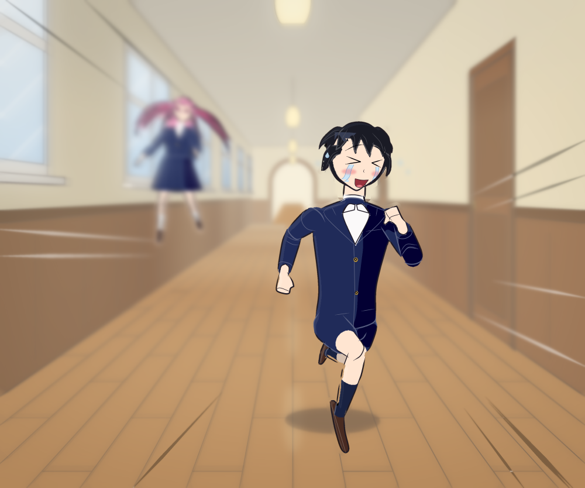
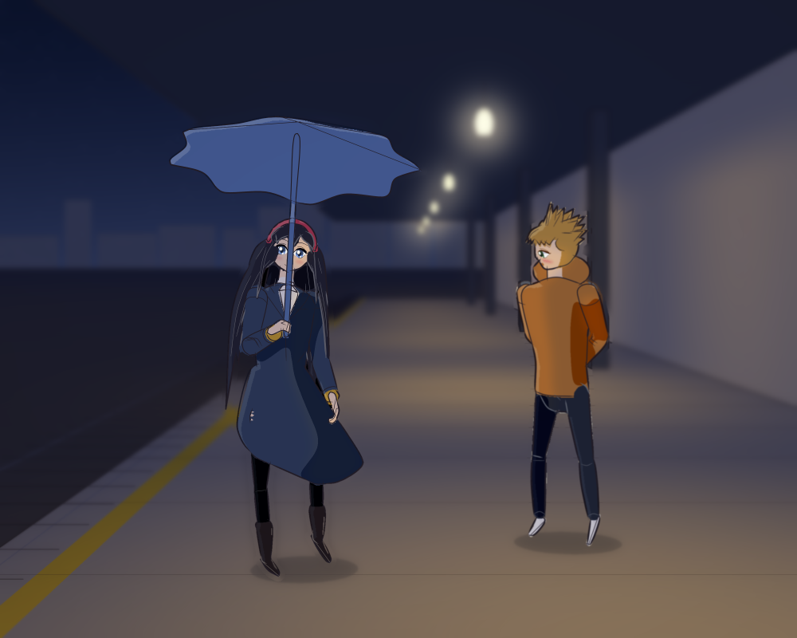
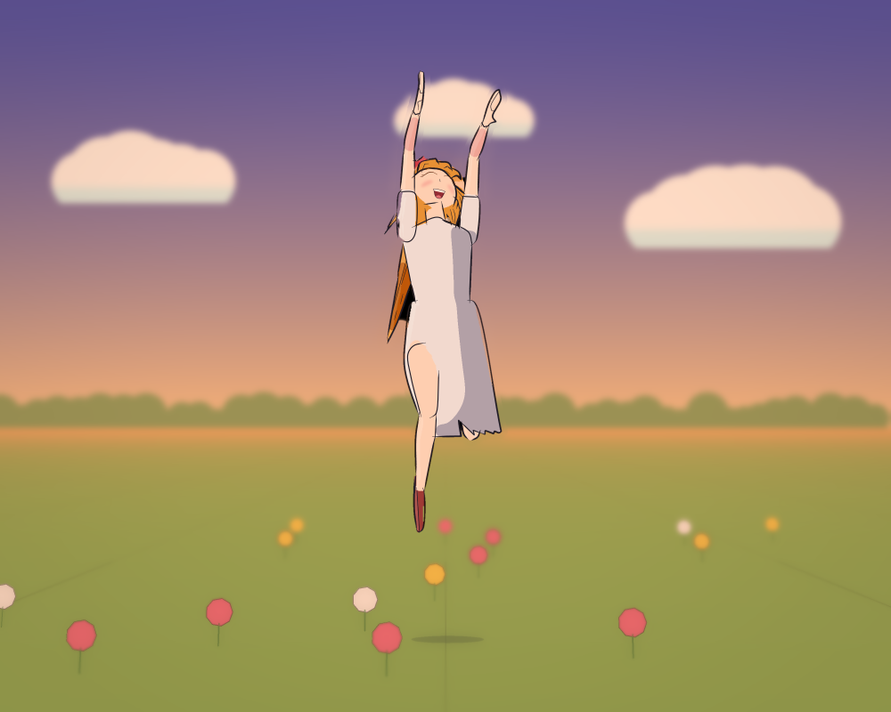
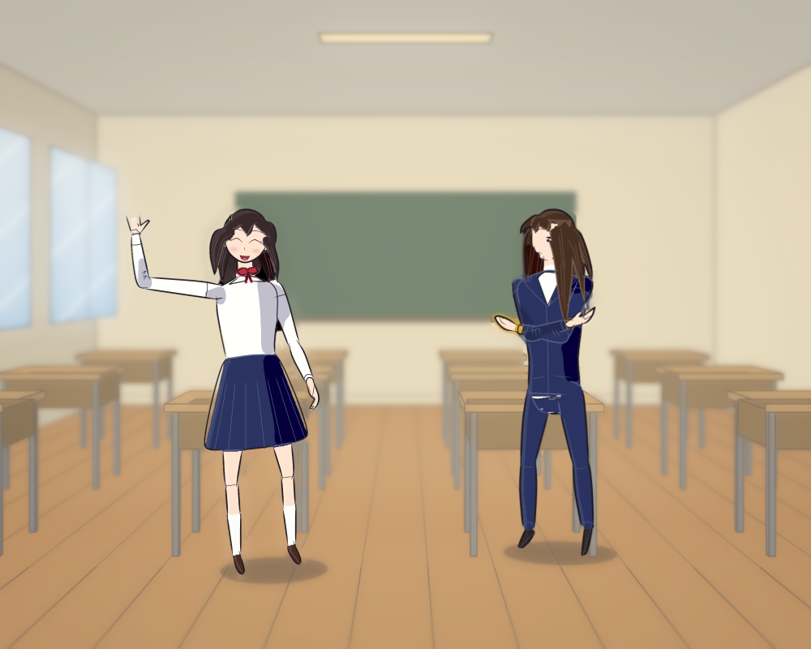

# pixelcanvas

**pixelcanvas is a command-line paint program your AI agent drives. Give it a reference picture and the agent redraws it
like a painter: it plans the regions, then works stage by stage (sketch, line, flat colour, shade, detail, finish).
After every command pixelcanvas reports what changed in numbers and writes a picture of the result; the agent opens it,
judges it, and goes on or undoes. Ask for a redraw with changes (mint-green hair, a poster, a lake behind the
figure), or describe a picture in words.**

[](LICENSE)


[繁體中文](README-zh.md)

pixelcanvas ships as one Python package with one command, `pixelcanvas`, and its Agent Skill,
[`skills/pixelcanvas/SKILL.md`](skills/pixelcanvas/SKILL.md).
It runs in Claude Code, opencode or any agent with a shell and a way to open image files, with hosted models and
with small local ones. numpy, Pillow, OpenCV, scikit-image and SciPy; no image model, no GPU, no network.

## Results

On a private set of 93 reference pictures (anime, landscape, promotional art), the redraw path reaches a judge
mean of 9.42 out of 10, and the judge rates 88 of the 93 redraws the same quality as the reference. In the redraw
path the strokes follow the reference and take their colours from it along the stroke, and no picture is retouched
pixel by pixel. A small open-weight model (Qwen 3.8 Flash class) driving the skill in Claude Code or opencode
finishes a redraw in about 19-45 minutes and 44-86 commands; its sessions now cover 23 anime pictures, with a judge
mean of 9.52 and 21 of 23 rated the same quality as the reference (the scripted path on the same pictures: 9.48,
22 of 23).

## Install

```bash
pip install pixelcanvas                  # the pixelcanvas command
pixelcanvas install-skill                # the skill -> ~/.claude/skills/pixelcanvas
pixelcanvas install-skill --opencode     # or -> ~/.config/opencode/skills/pixelcanvas
```

Then ask your agent: *"Redraw reference.jpg with pixelcanvas"*, *"Redraw reference.jpg as a minimalist poster"* or
*"Paint a mountain lake at sunset"*.
More ways (Claude Code plugin, `npx skills`, a clone): [docs/INSTALL.md](docs/INSTALL.md).

## How it works

The picture lives in a project folder, `pic.pixelcanvas/`: the reference, one PNG per layer, the regions, the undo
history and a journal of every command. Each command changes it and prints a report: the scores
`before -> after`, warnings, the worst spots, a `VIEW:` picture of the canvas, a `VIEW-REF:` picture of the
reference over the same area, and a `NEXT:` line with the command to run next.

The agent works in a loop: one command, read the report, open `VIEW`, say in one sentence whether it helped,
then follow `NEXT:` or `pixelcanvas undo`. Coordinates are 0-1000 on each axis, read off the rulers in the views.

Every stage paints on its own layer and has a gate that pixelcanvas measures per region. `pixelcanvas stage done` moves on
only when the gate passes, or when the agent gives a reason (`--because "..."`). `pixelcanvas todo --all` prints the
whole work list; the agent copies it into its own todo tool and ticks off each line.

### Three modes

| mode | start | who makes the marks |
|---|---|---|
| trace | `pixelcanvas new pic --ref reference.jpg --mode trace` | the stage commands follow the reference and take their colours from it; the agent plans regions, orders the work, checks each command and decides where to refine |
| hand | `pixelcanvas new pic --ref reference.jpg --mode hand` | the agent, mark by mark, with the reference beside it (experimental) |
| free | `pixelcanvas new pic --mode free --request "..."` | the agent, with construction tools, from a text request; it plans subjects and their parts, then goes through the same stages |

## A redraw, command by command

The trace-mode session the skill teaches, for an anime picture with dark outlines (style `cel`). One command per
shell call, and a look at `VIEW` after each:

```bash
pixelcanvas new pic --ref reference.jpg --mode trace      # guesses the style, shows numbered marks
pixelcanvas region add hair --marks 4,5,9,13              # regions from the numbered marks ...
pixelcanvas region add face --wand 500,550 --focus 3      # ... or a click inside a part
pixelcanvas region rest background
pixelcanvas stage done                                    # plan done
pixelcanvas todo --all                                    # the work list, in order
pixelcanvas do "sketch face; sketch hair; sketch background"
pixelcanvas stage done
pixelcanvas ink all                                       # line
pixelcanvas stage done
pixelcanvas flat all                                      # flat colour
pixelcanvas stage done
pixelcanvas shade all
pixelcanvas stage done
pixelcanvas detail all                                    # fine strokes over the whole picture, regions ranked
pixelcanvas detail face --level 1                         # hairlines, region by region in the ranked order
pixelcanvas look face
pixelcanvas dot all                                       # soft dots on glints and specks
pixelcanvas stage done
pixelcanvas look
pixelcanvas sharpen                                       # finishing sharpen fitted to the reference
pixelcanvas export final.png
pixelcanvas stage done
```

A painting or a photograph goes through block-in and forms (`pixelcanvas paint all`) instead of line, flat and shade.
`pixelcanvas next` always names the next command. When a stage tool misses a spot, the hand tools fix it:

```bash
pixelcanvas stroke "480,590 510,585 540,590" --size 3 --color pick --snap   # reference colour, pulled onto its edge
pixelcanvas fill 520,640 --color pick                                       # bucket fill inside the line art
pixelcanvas shape ellipse 470,440,500,470 --color "#ffffff"                 # an eye highlight
pixelcanvas erase 400,300,460,360 --layer line                              # remove marks in a box
```

## Redraw it, but ...

A request can ask for something the reference does not have: another colour, a poster, a new setting. Start the
project with the request, plan the regions as usual, and state each change before `pixelcanvas stage done`
(`pixelcanvas change add ...`; `pixelcanvas change none` for a plain copy). A change edits the target, the picture the stages
trace and score against; the original stays as `orig.png`. After the plan, a change stage makes the changes, and
the stages that follow trace the target. `pixelcanvas look --show changes` shows original and target side by side, and
`pixelcanvas next` names the next command throughout.

Recolour (*"with mint-green hair and a dark red top"*), after the regions `hair`, `face`, `clothes`, `background`:

```bash
pixelcanvas new pic --ref reference.jpg --mode trace --request "redraw it with mint-green hair and a dark red top"
pixelcanvas change add recolor hair --to "#8fdcb4"
pixelcanvas change add recolor clothes --to "#7b2635"
pixelcanvas stage done
pixelcanvas recolor hair --to "#8fdcb4"            # keeps shading, lines and highlights; reports hue before -> after
pixelcanvas recolor clothes --to "#7b2635"
pixelcanvas region refine hair --by hue            # when stray patches of the old colour remain
```

Poster (*"a minimalist poster titled SLOW SUMMER, navy line art on cream, coral accents"*):

```bash
pixelcanvas change add canvas --size 900x1200 --place 186,240,814,930 --color "#f3e9d8"
pixelcanvas change add palette map --to "#1d2a44,#f3e9d8" --accent "clothes=#e8644a"
pixelcanvas change add graphic disc 260,295,860,745 --color "#e97a62"
pixelcanvas change add text "SLOW SUMMER" --box 70,40,930,175 --font display --weight black --color "#1d2a44"
pixelcanvas stage done
pixelcanvas canvas --size 900x1200 --place 186,240,814,930 --color "#f3e9d8"
pixelcanvas palette map --to "#1d2a44,#f3e9d8" --accent "clothes=#e8644a"
pixelcanvas graphic disc 260,295,860,745 --color "#e97a62"
pixelcanvas style poster                           # the change gate asks for it once the target reads as a poster
```

New setting (*"in front of a mountain lake at sunset"*): the background is another pixelcanvas project, a picture file, a
gradient or one colour.

```bash
pixelcanvas change add cutout figure --regions face,hair,clothes
pixelcanvas change add background --gradient "#f2a65a,#5b5f8f"     # or --from lake.pixelcanvas, --from sky.png, --color "#88aacc"
pixelcanvas change add light
pixelcanvas stage done
pixelcanvas cutout figure --regions face,hair,clothes   # reports ground left in the figure and boxes the three weakest edge spots
pixelcanvas background --gradient "#f2a65a,#5b5f8f"
pixelcanvas light                                       # tints the figure toward the background's light, adds a rim light
pixelcanvas shadow figure                               # a contact shadow when the figure stands inside the picture
```

## Drawing from a text request

With no reference, a picture of people in a place is built coarse to fine. A `scene` kit draws the place from the
camera; each figure is posed, dressed and given hair and a face on a 3D skeleton in one `figure` line; `render`
turns the figures into a faded guide that is never exported; the picture is drawn in 2D over it: anime line art,
flat colour, cel shadows, faces, then `polish` for the finish.

```bash
pixelcanvas new pic --mode free --size 1000x834 --request "two children in a school corridor"
pixelcanvas do @steps.txt                          # camera, scene, figures (below)
pixelcanvas render                                 # the 3D guide
pixelcanvas do "draw all; flat auto; shade all"    # 2D line art, flat colour, cel shadows over the guide
pixelcanvas polish --focus boy --motion boy:toward     # rim light, depth of field, motion trail, glow, vignette
pixelcanvas export final.png --stages stages
pixelcanvas stage done                             # status FINISHED
```

Every picture below was drawn by pixelcanvas with that sequence; only `steps.txt` and the `polish` options differ.

| | |
|---|---|
|  |  |
|  |  |

`steps.txt` of the corridor (`polish --focus boy --motion boy:toward`):
```text
camera --horizon 400 --eye-height 1.1
scene corridor --time day --wall "#e6dcc4" --trim "#8a5a3a" --floor "#b07a4a" --lamps 4 --arch
figure boy --pose run-toward --at 600,960 --heads 5.5 --yaw 10 --wear "jacket:#232c58,shorts:#232c58,socks:#1c2340,shoes:#4a2c20" --hair "short,side,#1c1c24" --face "crying,#3a3a3a"
figure girl --pose float --at 300,600 --heads 5.5 --yaw 0 --wear "jacket:#232c58,skirt:#232c58:pleated,socks:white,shoes:#4a2c20" --hair "twintails,blunt,#f09ac0,bows:black" --face "smug,#b04080"
```

The night platform (`polish --focus girl`):
```text
camera --horizon 420 --eye-height 1.4 --fov 50
scene platform --time night --lamps 4
figure girl --pose umbrella --at 380,900 --heads 6.5 --yaw 25 --look camera --wear "coat:#3a4a6a:knee,thigh-highs:black,boots:#2a2020" --hair "long,blunt,#2a2a3a,hairband,bows:#c04060" --face "smile,#6a8ad0"
figure boy --pose hands-behind --at 700,860 --heads 6.5 --yaw -30 --look left --wear "hoodie:#c08040,pants:#2a3040,shoes:white" --hair "spiky,side,#d0a050" --face "embarrassed,#4a7a4a"
```

The field at sunset (`polish --focus girl --motion girl:up`):
```text
camera --horizon 600 --eye-height 0.8 --fov 50 --tilt 8
scene field --time sunset
figure girl --pose jump --at 500,900 --heads 6 --yaw 15 --look up --energy 1 --wear "dress:#f0f0f8,shoes:#a04040" --hair "ponytail,side,#e8a040,ribbon,bows:#d04050,wind:left" --face "laugh,#3a8a5a"
```

The classroom (`polish --focus girl`):
```text
camera --horizon 430 --eye-height 1.3 --fov 50
scene classroom --time day
figure girl --pose wave --at 330,880 --heads 6.5 --yaw 20 --look camera --wear "blouse:white,ribbon:#c03040,skirt:#2c3460:pleated,socks:white,shoes:#4a2c20" --hair "bob,blunt,#3a2a2a,hairpin,bows:#e0c040" --face "grin,#8a5030"
figure boy --pose arms-crossed --at 680,860 --heads 6.5 --yaw -25 --look left --wear "blazer:#2c3460,shirt:white,pants:#2c3460,shoes:#2a2020" --hair "medium,parted,#4a3020" --face "smug,#305080"
```

- `scene list`: corridor, room, classroom, street, platform, outdoor, field, beach, rooftop, stairs, with
  `--time day|sunset|night` and a colour per surface.
- `figure <who>`: `--wear` pieces `piece[:colour][:style]`, `--hair` style, bangs, colour and accessories,
  `--face` expression (18), eye colour and gaze; every other option is a `pose` option: 73 presets
  (`pixelcanvas pose list`), `--lean --twist --bend`, `--look`, `--arm-r`, `--leg-l`, `--hand-shape-r`,
  `--hand-r-to`, `--check`.
- A re-pose updates the guide by itself; `pixelcanvas draw girl --part arm-r` redraws one part;
  `pixelcanvas help pose,figure,scene` prints the options and values of several commands at once.

Without people, a picture is planned with boxes and painted through the stages with construction tools
(`plan subject`, `sketch`, `line`, `flat auto`, `shade`, `band`, `eye`, `hair --flow`, `fold`, `text`, `polish`).

### Claude Code plugin

The plugin adds `/pixelcanvas:draw <request>` and four subagents that build a new picture from the coarsest
decision down: `pixelcanvas-director` writes the brief and `steps.txt` (camera, scene, figures),
`pixelcanvas-blocker` runs it in one `do @steps.txt` and renders the guide, `pixelcanvas-painter` draws and
finishes, and `pixelcanvas-critic` checks the guide and the final picture against the brief with a judge's
criteria and names the owner and the command for each fix. A two-figure picture takes about ten pixelcanvas
commands.

## Commands

`pixelcanvas help`:

```text
pixelcanvas: a paint program. Coordinates are 0-1000 on each axis (x right, y down).
after each command: read the report, open VIEW (the canvas) and, to compare, VIEW-REF (the reference)
setup:   new  style  mode hand  status  next  todo [--all]  stage  undo [n]  redo
look:    look [region|box] [--show both|canvas|ref|diff|marks|layers] [--grid]   marks   pick   palette   score
regions: region add <name> --marks 3,4 | --box x0,y0,x1,y1 | --poly "x,y ..." | --wand x,y  [--focus 1-3]; region rest background; region focus <name> 3; region list; region remove <name>
stages:  sketch  ink  flat  shade  paint [--size N]  airbrush  detail [--level 2|1]  dot  retouch <region>   (each takes a region, default all; no options = the engine's own settings for the style)
hand:    stroke  fill  shape  gradient  erase  smooth  adjust   (act on the stage's layer or --layer)
changes: change add <kind> ...  change list  change drop <n>  change none   (state what the request changes from the reference; kinds: canvas recolor palette graphic cutout background light shadow text shape)
         recolor <region> --to "#hex"   region refine <region> --by lines|hue   canvas --size WxH --place x0,y0,x1,y1 [--color "#hex"]   palette map --to "dark,...,light" [--accent "region=#hex"]   graphic disc|rect|ring|frame <box> --color "#hex"
         cutout <subject> --regions a,b,c   background --from <pixelcanvas project|picture> | --gradient "#a,#b" | --color "#hex"   light [--tint "#hex"] [--rim left|right]   shadow <subject>
free:    no reference: plan  palette make|pick|set  sketch figure|head|ellipse|box|curve  line  band  face  eye  hair  locks  blush  hand  wear  fold  crease  tufts  mark  pattern  scatter  surface  highlight  rim  shadow --from <part> --onto <part>  reflect  wet  haze  atmosphere  glow  cloud  ground  foliage  window  linestyle
3D:      camera --horizon <y> --eye-height <m>   pose <subject> --preset run --at x,y --yaw <deg> --set "arm-r: raise 90; knee-l: 60" [--on <block>] [--hand-r <block|x,y>]   pose list   block <name> box|stairs|cylinder|plane|railing --at x,y --size w,d,h   prop <name> --kind sword --hand r   form <subject>   dress <subject> blouse,skirt,shoes --color navy   dress list   hair3d <subject> --style long|twintails|... --bangs blunt --color pink   render (the 3D guide)   draw <subject>|all|scene [--part hair|face|arm-r|...]   shade <subject>|all (cel shadows)   face <subject> --expression crying
finish:  polish (one finishing pass over a drawn picture; --no-<part> leaves a part out)   sharpen (the finishing sharpen, fitted to the reference)   fx <glow|grain|blur|vignette|paper|sharpen|levels> [region] [--amount 0..1]   text "<string>" --box x0,y0,x1,y1 [--font --color --align --outline px,#hex --vertical --fit]   fonts
other:   layer  export <file.png> [--psd] [--ora] [--timelapse film.gif|film.mp4] [--stages dir]   do "<cmd>; <cmd>"   help [command]
NEXT: pixelcanvas next
```

`--help` after any command prints its options and an example. `pixelcanvas export final.png --psd --ora` also writes the
layers for Photoshop, Krita or GIMP; `--timelapse film.gif` replays the journal; `--stages dir` saves one picture
per stage.

## Develop

```bash
git clone https://github.com/treeleaves30760/pixelcanvas
cd pixelcanvas
pip install -e ".[test]"
python -m pytest tests -q
```

The code is in `pixelcanvas/`, the tests in `tests/`, the skill in `skills/pixelcanvas/SKILL.md`.
[CLAUDE.md](CLAUDE.md) has the project map and the release steps; [CHANGELOG.md](CHANGELOG.md) the history.
Version 0.6.0 replaced the old code-drawing tool with pixelcanvas.

## License

MIT
