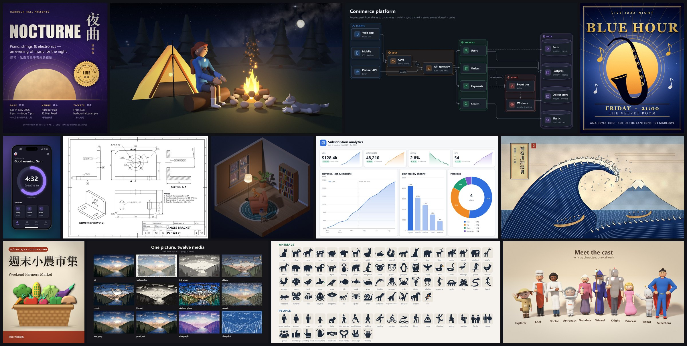

# pixelcanvas

**Your coding agent draws finished pictures with code. No image model.**



pixelcanvas is an Agent Skill and a Python library. Claude Code, Codex, Cursor, opencode or any agent that can run
Python reads the skill, picks a kit for the request, writes a short scene file and renders it with numpy + Pillow.
Every picture is code: exact text in any language, editable layers, and a `--check` report that tells the agent what
to fix before it hands the picture over.

## What it draws

- **Posters, cards, banners and wallpapers** with strong typography, 57 backdrops, 60 palettes and 43 art styles
  (oil, watercolour, ukiyo-e, risograph ...).
- **Diagrams, charts, dashboards and UI screens** with automatic layout, exported as PNG and SVG.
- **Technical drawings and floor plans**: views, sections, dimensions, exported as SVG and DXF.
- **3D scenes**: ray-marched prefabs, studio product shots, isometric rooms, and clay characters and animals in 31
  poses and 64 species.
- **Illustration**: posed people, animals, trees and flowers, fire, water and skies, 80 lit materials and 633
  pictograms.

## Install

```bash
pip install pixelcanvas
pixelcanvas doctor
```

Or run it without installing: `uvx pixelcanvas doctor`.

Give the skill to your agent (Claude Code by default; also `agents`, `codex`, `cursor`, `opencode`):

```bash
pixelcanvas install-skill claude
```

This installs two skills: `pixelcanvas` (Python scenes, every kit) and `pixelcanvas-lite` (a small JSON spec, made
for small local models). Then ask your agent: *"draw me a poster for a jazz night"*.

The MCP server works with any MCP client: `pixelcanvas mcp`.

## A first picture in three commands

```bash
pixelcanvas compose --example poster > poster.json
pixelcanvas compose poster.json --check
pixelcanvas compose poster.json --deliver final/
```

The first command writes a complete poster spec (a title, a backdrop, three potted plants, the date and place), the
second draws a draft and reports what to fix, the third renders it full size into `final/poster.png`. Edit the JSON,
or ask your agent to, and run it again.

For any other picture your agent runs the same loop in Python:

```bash
pixelcanvas kit find "a corgi sitting under an oak tree at sunset"
pixelcanvas new corgi --prompt "a corgi sitting under an oak tree at sunset"
pixelcanvas render corgi.py --scale 0.5 --check
```

`kit find` names the call for each subject of the request, `new` writes a starter scene for it, and `render --check`
draws a draft and prints what to improve. `pixelcanvas --help` lists every command.

## More

The gallery, the full documentation and every kit's reference page are on GitHub:
[github.com/treeleaves30760/pixelcanvas](https://github.com/treeleaves30760/pixelcanvas#readme).
Release notes: [CHANGELOG](https://github.com/treeleaves30760/pixelcanvas/blob/main/CHANGELOG.md).
