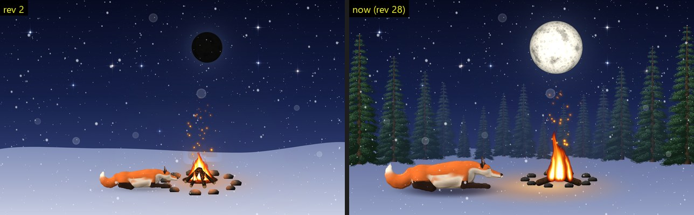
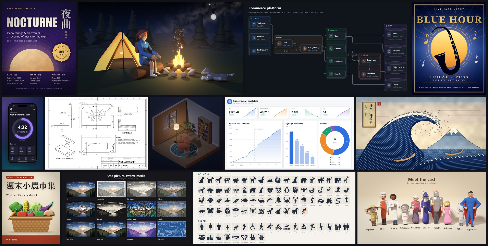

# pixelcanvas

**Your coding agent draws finished pictures with code, then keeps making them better. No image model.**



pixelcanvas is an Agent Skill and a Python library. Claude Code, Codex, Cursor, Gemini CLI, opencode or any agent
that can run Python, local models included, draws in `pixelcanvas studio`: the picture is a stack of layers, one `# %% name`
section of a draft file per object, and every command changes one thing, re-renders only that, checks the picture
against the draft's inventory lines and prints one `NEXT:` line. A finished drawing can be delivered in a real art medium
(render, flat, oil, watercolour, ink, pixel art). Exact text in any language, PSD / ORA layers, numpy + Pillow.



## What it draws

- **Posters, cards, banners and wallpapers** with strong typography, 57 backdrops, 60 palettes and 43 art styles
  (oil, watercolour, ukiyo-e, risograph ...).
- **Diagrams, charts, dashboards and UI screens** with automatic layout, exported as PNG and SVG.
- **Technical drawings and floor plans**: views, sections, dimensions, exported as SVG and DXF.
- **3D scenes**: ray-marched prefabs, studio product shots, isometric rooms, and clay characters and animals in 31
  poses and 64 species.
- **Illustration**: posed people, animals, trees and flowers, fire, water and skies, 80 lit materials and 633
  pictograms.

## Install

```bash
pip install pixelcanvas
pixelcanvas doctor
```

Or run it without installing: `uvx pixelcanvas doctor`.

Give the skill to your agent (Claude Code by default; also `agents`, `codex`, `cursor`, `opencode`):

```bash
pixelcanvas install-skill claude
```

This installs two skills: `pixelcanvas` (the studio, every kit) and `pixelcanvas-lite` (a small JSON spec, made for
the smallest local models). Then ask your agent: *"draw me a poster for a jazz night"*.

The MCP server works with any MCP client: `pixelcanvas mcp`.

## The studio loop

```bash
# the agent writes art/corgi/draft.py: one '# %% name' section per object, each starting with its inventory line
#   # corgi: 1, orange and white, sitting | under tree
pixelcanvas studio new corgi --prompt "a corgi sitting under an oak tree at sunset" --size 1920x1080 --out corgi.png --from art/corgi/draft.py
pixelcanvas studio scale corgi 1.3
pixelcanvas studio add --from art/corgi/draft.py
pixelcanvas studio set scene medium=oil                 # deliver it as an oil painting (watercolour, ink, pixel ...)
pixelcanvas studio deliver corgi_large.png --scale 2 --layers
```

`new --from` creates the picture and draws the first draft in one command; the inventory lines are the checklist.
`scale` and the other one-command changes (`move`, `fit`, `put`, `order`, `copy`, `recolor`, `crop`, `set`) change a
layer without drawing it again, and `add --from` redraws only the sections you edited. Each report ends with one
`NEXT:` line; when nothing measured is open it opens `look.png` (the picture, then each item close up), and after three
looks it says the picture is finished. `corgi.png` is kept current after every command, and a later "make the corgi
bigger" is one more command on the same picture. `set scene medium=` repaints the finished drawing in a render, flat, oil, watercolour, ink or pixel look without running a
section again. `deliver` writes a larger copy, or PSD and ORA with one layer per
object. `pixelcanvas studio help` lists all of them.

## A picture from one JSON file

```bash
pixelcanvas compose --example poster > poster.json
pixelcanvas compose poster.json --check
pixelcanvas compose poster.json --deliver final/
```

The first command writes a complete poster spec (a title, a backdrop, three potted plants, the date and place), the
second draws a draft and reports what to fix, the third renders it full size into `final/poster.png`. Edit the JSON,
or ask your agent to, and run it again.

`pixelcanvas kit find "a corgi sitting under an oak tree at sunset"` names the kit call for each subject of a
request, and `pixelcanvas --help` lists every command.

## More

The gallery, the full documentation and every kit's reference page are on GitHub:
[github.com/treeleaves30760/pixelcanvas](https://github.com/treeleaves30760/pixelcanvas#readme).
Release notes: [CHANGELOG](https://github.com/treeleaves30760/pixelcanvas/blob/main/CHANGELOG.md).
